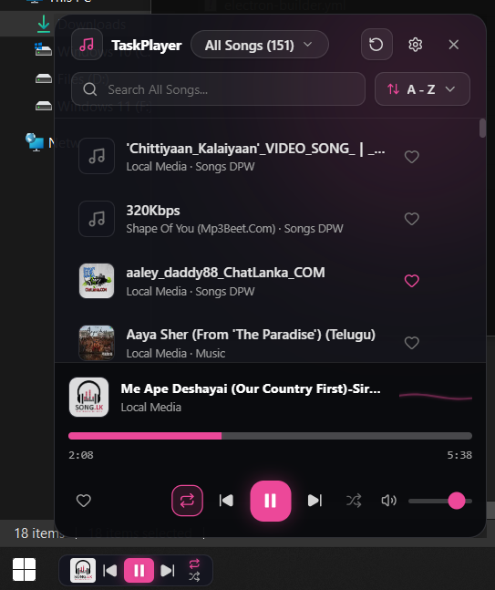
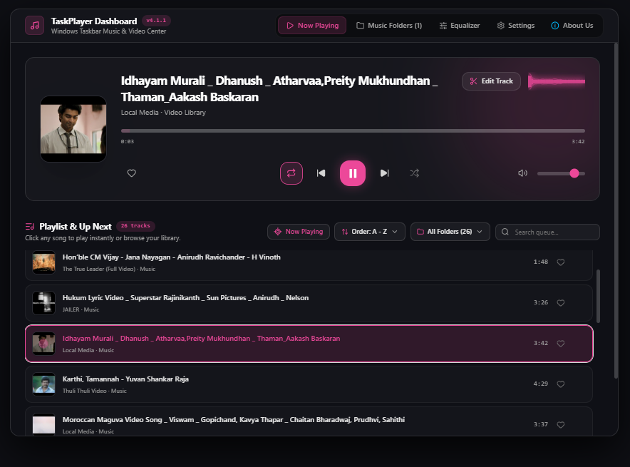
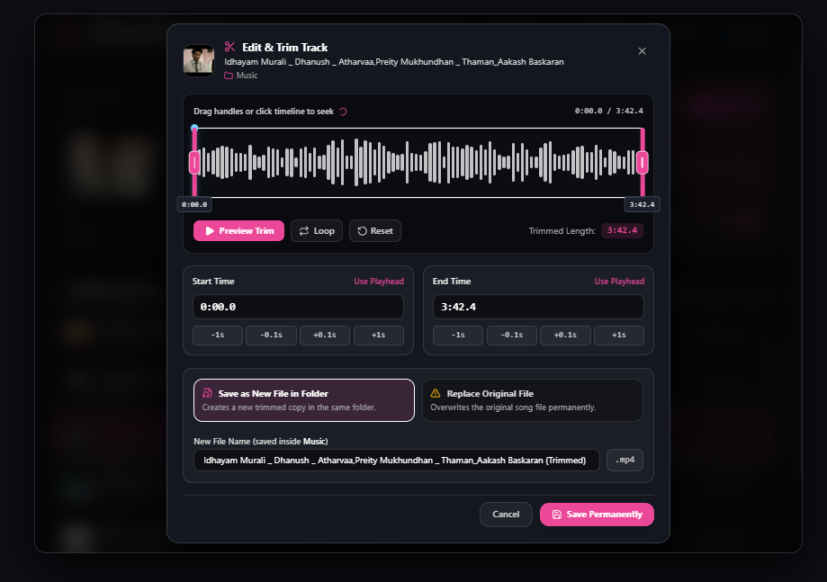
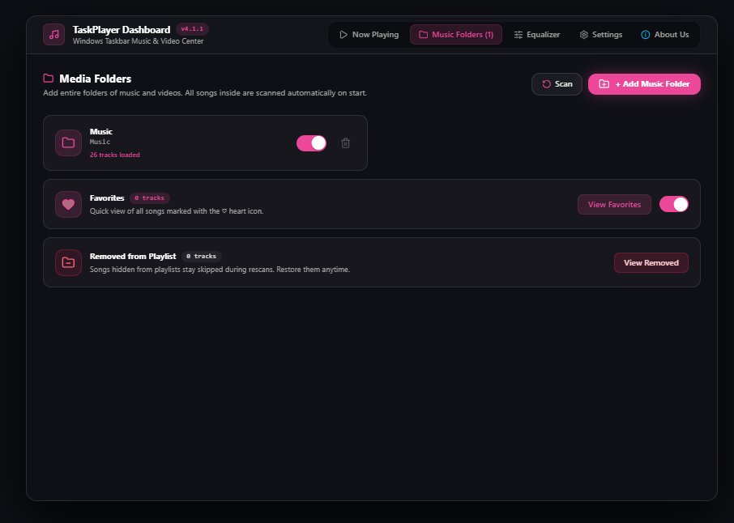
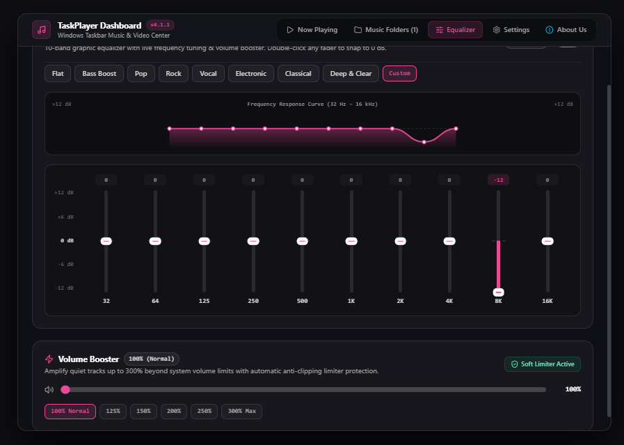
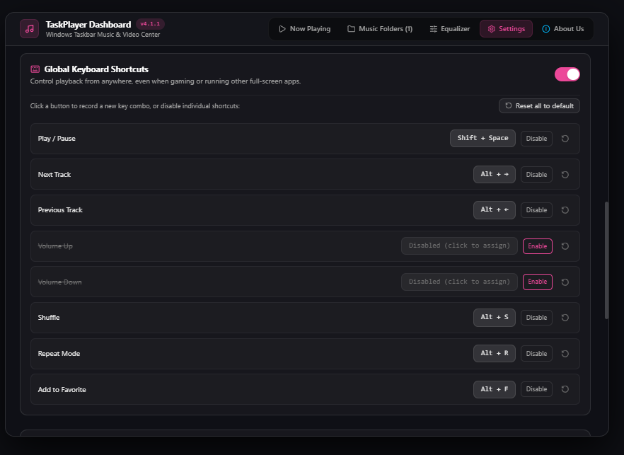
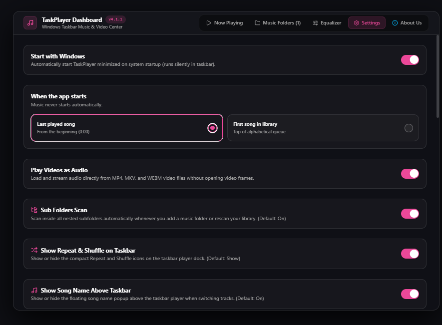
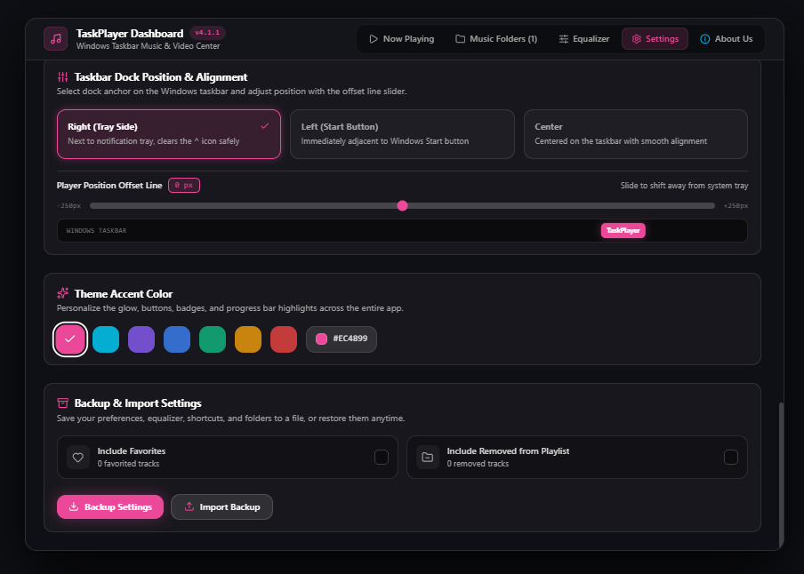

# 🎵 TaskPlayer (`v4.1.1`)

**Windows Taskbar Music & Video Center** — a desktop media player for Windows that docks directly onto the taskbar with a compact mini-player, flyout library view, full dashboard, built-in audio trimmer, 10-band equalizer, and volume booster.

---

## 📸 Screenshots

| Taskbar Flyout & Mini Player | Dashboard & Queue |
| :---: | :---: |
|  |  |

| Edit & Trim Track | Media Folders & Library |
| :---: | :---: |
|  |  |

| 10-Band Equalizer & Volume Booster | Global Keyboard Shortcuts |
| :---: | :---: |
|  |  |

| Startup & Playback Settings | Taskbar Dock, Theme & Backup |
| :---: | :---: |
|  |  |

---

## ✨ Key Features

### 🖥️ Windows Taskbar Dock & Flyout
* **Taskbar Player Dock:** Compact taskbar playback bar with track cover, play/pause, previous/next controls, repeat & shuffle toggles (configurable), and an optional floating song name popup above the taskbar.
* **Flexible Taskbar Positioning:** Dock to **Right (Tray Side)**, **Left (Start Button)**, or **Center**, and fine-tune horizontal alignment with the **Player Position Offset Line** slider (`-250px` to `+250px`).
* **Library Flyout:** Search across all loaded songs (`Search All Songs...`), sort (`A - Z`), filter playlists, and toggle favorites quickly.

### 🎚️ Equalizer & Volume Booster
* **10-Band Graphic Equalizer (`32 Hz` – `16 kHz`):** Live frequency response curve with presets (**Flat**, **Bass Boost**, **Pop**, **Rock**, **Vocal**, **Electronic**, **Classical**, **Deep & Clear**) plus **Custom** band tuning and double-click snap to `0 dB`.
* **Volume Booster (Up to 300%):** Boost quiet tracks (`100% Normal`, `125%`, `150%`, `200%`, `250%`, `300% Max`) with **Soft Limiter** anti-clipping protection.

### ✂️ Edit & Trim Track
* **Waveform Timeline & Fine Controls:** Drag handles or click the waveform timeline to set **Start Time** and **End Time**, adjust with **Use Playhead** or `-1s` / `-0.1s` / `+0.1s` / `+1s` step buttons, preview with **Loop** or **Reset**, and see exact **Trimmed Length**.
* **Save Options:** Save as a new file in the folder with a custom file name or replace the original file.

### 📁 Media Folders, Video-as-Audio & Library
* **Folder Scanning & Subfolders:** Add music folders, rescan anytime, and scan nested subfolders automatically (**Sub Folders Scan**).
* **Play Videos as Audio:** Stream audio directly from **MP4**, **MKV**, and **WEBM** files without opening video frames.
* **Favorites & Removed Tracks:** Mark favorite tracks (`♡` / heart) and manage tracks hidden/removed from playlists with restore support.

### ⌨️ Global Shortcuts, Startup, Themes & Backup
* **Global Keyboard Shortcuts:** Control playback from anywhere (even during full-screen apps/games), customize key combinations, disable individual shortcuts, or reset to defaults (e.g., `Shift + Space` for Play/Pause, `Alt + →` / `Alt + ←` for Next/Previous Track, `Alt + S` for Shuffle, `Alt + R` for Repeat Mode, `Alt + F` for Add to Favorite).
* **Startup Behavior:** Option to **Start with Windows** minimized in the taskbar and choose startup queue behavior (**Last played song** from `0:00` or **First song in library**).
* **Theme Accent Color:** Customize highlights, buttons, badges, and progress bars across the app (including `#EC4899` and preset swatches).
* **Backup & Import Settings:** Export and import preferences, equalizer settings, shortcuts, and folders, with optional toggles to include **Favorites** and **Removed from Playlist** items.

---

## 📦 Installation & Releases

1. Go to the **Releases** section on this repository.
2. Download and run the Windows installer for **TaskPlayer `v4.1.1`**.
3. Open **TaskPlayer Dashboard** → **Music Folders** to add your music/media folders and start listening.

---

## 📄 License

This project is licensed under the **MIT License** — see the `LICENSE` file for details.